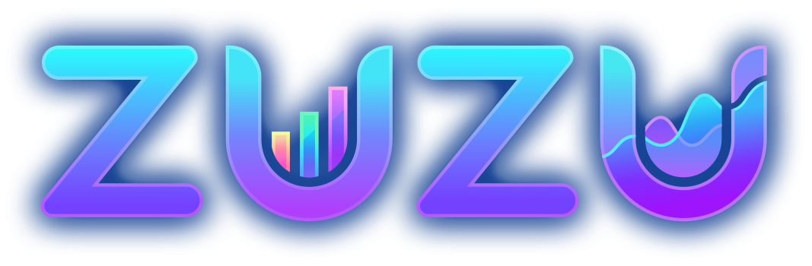
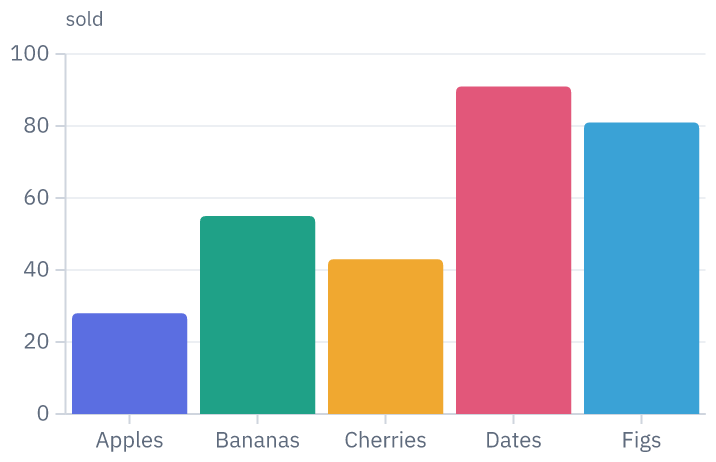
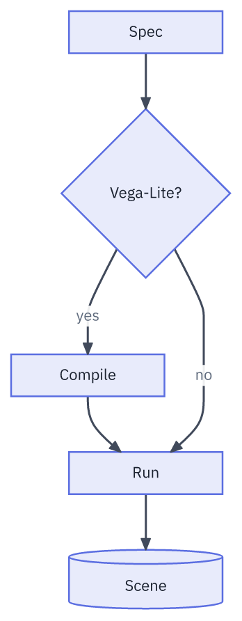
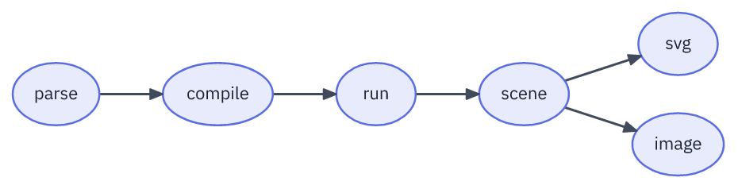
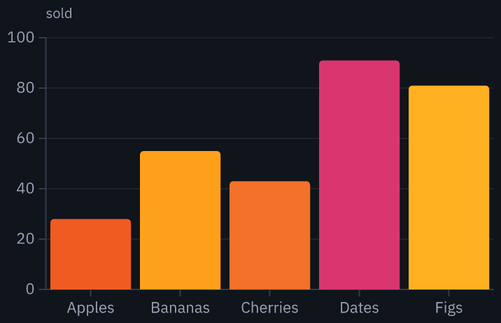
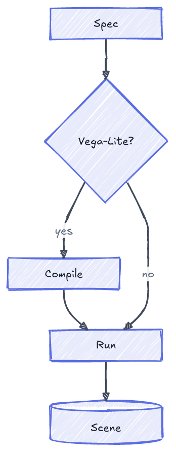
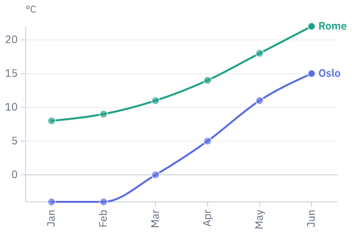

<div align="center">
  
  <br/>
  <a href="#about" title="About">About</a> |
  <a href="#examples" title="Examples">Examples</a> |
  <a href="#design" title="Design">Design</a> |
  <a href="#documents" title="Documents">Documents</a> |
  <a href="#contributing" title="Contributing">Contributing</a> |
  <a href="https://pkg.go.dev/github.com/xo/zuzu" title="Go Reference">Reference</a>
</div>

<br/>

[![Unit Tests][zuzu-ci-status]][zuzu-ci]
[![Go Reference][goref-zuzu-status]][goref-zuzu]
[![Releases][release-status]][releases]
[![Discord Discussion][discord-status]][discord]

[zuzu-ci]: https://github.com/xo/zuzu/actions/workflows/test.yml "Test CI"
[zuzu-ci-status]: https://github.com/xo/zuzu/actions/workflows/test.yml/badge.svg "Test CI"
[goref-zuzu]: https://pkg.go.dev/github.com/xo/zuzu "Go Reference"
[goref-zuzu-status]: https://pkg.go.dev/badge/github.com/xo/zuzu.svg "Go Reference"
[release-status]: https://img.shields.io/github/v/release/xo/zuzu?display_name=tag "Latest Release"
[releases]: https://github.com/xo/zuzu/releases "Releases"
[discord]: https://discord.gg/WDWAgXwJqN "Discord Discussion"
[discord-status]: https://img.shields.io/discord/829150509658013727.svg?label=Discord&logo=Discord&colorB=7289da&style=flat-square "Discord Discussion"

# About

`zuzu` draws charts and diagrams in pure Go, with no cgo. You give it a
declarative spec, which says what to draw from which data. zuzu writes the
chart as SVG or draws it as an image.

The spec follows [Vega][vega] and [Vega-Lite][vega-lite]. A spec written for
the Vega tools works with zuzu, as far as zuzu supports it. zuzu also reads
the DOT language of Graphviz and every kind of diagram of Mermaid 12.3.
[`docs/DIAGRAMS.md`](docs/DIAGRAMS.md) lists what it reads.

zuzu draws its own look, with a light and a dark mode and color schemes that
you swap apart from the mode. It can also draw any chart or diagram as if by
hand. It draws an image with [`okage`][okage], a pure Go port of resvg, and
it measures and draws text in the fonts that it bundles. The same spec gives
the same image on every machine of one architecture.

Add zuzu to a module:

```bash
go get github.com/xo/zuzu
```

# Examples

The code below comes from the examples of the package, which `go test`
runs. Each image is a PNG that `Chart.Image` drew from that code. The test
`TestTheReadmeImagesAreDrawn` draws the images again with `-update`.

## A chart from Vega-Lite

`zuzu.Parse` reads a Vega-Lite or a Vega spec, and `Chart.Image` draws it.
The report lists each feature of the spec that zuzu did not draw.

```go
ctx := context.Background()
src := []byte(`{
  "$schema": "https://vega.github.io/schema/vega-lite/v6.json",
  "width": 320,
  "height": 180,
  "data": {"values": [
    {"fruit": "Apples", "sold": 28},
    {"fruit": "Bananas", "sold": 55},
    {"fruit": "Cherries", "sold": 43},
    {"fruit": "Dates", "sold": 91},
    {"fruit": "Figs", "sold": 81}
  ]},
  "mark": "bar",
  "encoding": {
    "x": {"field": "fruit", "type": "nominal", "title": null, "axis": {"labelAngle": 0}},
    "y": {"field": "sold", "type": "quantitative"},
    "color": {"field": "fruit", "legend": null}
  }
}`)
chart, _, err := zuzu.Parse(src)
if err != nil {
	log.Fatal(err)
}
img, report, err := chart.Image(ctx)
if err != nil {
	log.Fatal(err)
}
for _, issue := range report {
	log.Println(issue)
}
var buf bytes.Buffer
if err := png.Encode(&buf, img); err != nil {
	log.Fatal(err)
}
```



`png.Encode` writes the image to any `io.Writer`, such as a file. A `Chart`
does not change after `Parse`, so many goroutines can draw one `Chart` at
the same time.

## SVG

`Chart.SVG` writes the same chart as SVG:

```go
var buf bytes.Buffer
report, err := chart.SVG(ctx, &buf)
```

The SVG names the font IBM Plex Sans, and a viewer that does not have the
font draws the text in another one. `Chart.Image` draws the text in the
bundled font, so the image looks the same everywhere.

## A Mermaid diagram

`zuzu.Parse` finds a diagram of Mermaid or of DOT by its first word. Draw it
as you draw a chart:

```go
src := []byte(`flowchart TD
  A[Spec] --> B{Vega-Lite?}
  B -- yes --> C[Compile]
  B -- no --> D[Run]
  C --> D
  D --> E[(Scene)]`)
chart, _, err := zuzu.Parse(src)
```

<picture>
  <source media="(prefers-color-scheme: dark)" srcset="docs/readme/flowchart-dark.png"/>
  
</picture>

## A DOT graph

```go
src := []byte(`digraph {
  rankdir=LR
  parse -> compile -> run -> scene
  scene -> svg
  scene -> image
}`)
chart, _, err := zuzu.Parse(src)
```

<picture>
  <source media="(prefers-color-scheme: dark)" srcset="docs/readme/graph-dark.png"/>
  
</picture>

## Dark mode and color schemes

A theme is a mode, light or dark, and a color scheme. The mode sets the
background, the text and the axes. The scheme sets the colors of the data.
Give either one to a render:

```go
img, report, err := chart.Image(ctx,
	zuzu.WithMode(theme.Dark),
	zuzu.WithScheme(theme.Ember),
)
```

| The light mode and the scheme `zuzu` | The dark mode and the scheme `ember` |
| --- | --- |
|  |  |

`theme.Schemes` returns the names of the schemes, and `theme.Lookup` finds
one by its name. [`docs/STYLE.md`](docs/STYLE.md) describes each one.

## The hand-drawn look

`zuzu.WithLook(theme.LookExcalidraw)` draws each mark as if by hand, as
Excalidraw does. The package `text/excalifont` holds the font of the look,
Excalifont. Give it with `zuzu.WithLookFont`, so that zuzu measures and
draws the text in it:

```go
look := zuzu.WithLook(theme.LookExcalidraw)
font := zuzu.WithLookFont(theme.LookExcalidraw, excalifont.Font())
chart, _, err := zuzu.Parse(src, look, font)
```

<picture>
  <source media="(prefers-color-scheme: dark)" srcset="docs/readme/sketch-dark.png"/>
  
</picture>

The look works for a chart too. The SVG embeds the font, so a viewer draws
the text in Excalifont.

## Data from a loader

zuzu reads no file and makes no request of its own. A spec that names its
data by `url` reads it through the loader that you give with
`zuzu.WithLoader`. `zuzu.FSLoader` reads each url as a path in a file system
that you choose:

```go
src := []byte(`{
  "$schema": "https://vega.github.io/schema/vega-lite/v6.json",
  "width": 320,
  "height": 180,
  "data": {"url": "temps.csv"},
  "mark": {"type": "line", "point": true},
  "encoding": {
    "x": {"field": "month", "type": "ordinal", "sort": null, "title": null},
    "y": {"field": "temp", "type": "quantitative", "title": "°C"},
    "color": {"field": "city", "title": null}
  }
}`)
// Any fs.FS works, such as os.DirFS("data").
fsys := fstest.MapFS{"temps.csv": {Data: []byte(`month,city,temp
Jan,Oslo,-4
Feb,Oslo,-4
Mar,Oslo,0
Apr,Oslo,5
May,Oslo,11
Jun,Oslo,15
Jan,Rome,8
Feb,Rome,9
Mar,Rome,11
Apr,Rome,14
May,Rome,18
Jun,Rome,22
`)}}
chart, _, err := zuzu.Parse(src)
if err != nil {
	log.Fatal(err)
}
img, report, err := chart.Image(ctx, zuzu.WithLoader(zuzu.FSLoader(fsys)))
```

<picture>
  <source media="(prefers-color-scheme: dark)" srcset="docs/readme/line-dark.png"/>
  
</picture>

`zuzu.WithValues` gives the rows of a dataset directly, without a loader.
[`docs/API.md`](docs/API.md) lists every option.

# Design

zuzu has four stages. Each stage hands the next one a value that can be
written as JSON:

1. A front end reads Vega, Vega-Lite, DOT or Mermaid, and produces a spec
   in the shape of a Vega spec.
2. The runtime loads the data, runs the transforms and the expressions,
   builds the scales and lays out the axes and the legends.
3. The result is a scene graph: a tree of shapes with their final positions,
   sizes and colors.
4. A renderer writes the scene graph as SVG, or draws it with okage.

zuzu runs static Vega, which is Vega without the events of a mouse or a
keyboard, and the Vega-Lite that compiles to it. A corpus of 579 Vega-Lite
specs and 87 Vega specs from [`vegagoja`][vegagoja], with the output of
vega.js for each, measures how far zuzu agrees with Vega. Later, zuzu will
send live charts to a web browser and draw the results of a query for
[`usql`][usql].

# Documents

| Document | What it holds |
| --- | --- |
| [`docs/PLAN.md`](docs/PLAN.md) | the plan, the architecture, the phases and the open questions |
| [`docs/API.md`](docs/API.md) | the public API |
| [`docs/EXPRESSIONS.md`](docs/EXPRESSIONS.md) | the expression language, and the choices for scripting beyond it |
| [`docs/decisions/`](docs/decisions/README.md) | every decision, one file each, with an index |
| [`docs/BACKLOG.md`](docs/BACKLOG.md) | the work that is known and not done |
| [`docs/STYLE.md`](docs/STYLE.md) | the rules and the tokens of the look, the modes and the color schemes |
| [`docs/DIAGRAMS.md`](docs/DIAGRAMS.md) | the parts of DOT and of Mermaid that zuzu reads |
| [`docs/targets/`](docs/targets/README.md) | the target SVGs that show the look zuzu aims for |
| [`docs/survey/`](docs/survey/README.md) | the survey of other libraries, and the page that compares them |
| [`docs/UPSTREAM.md`](docs/UPSTREAM.md) | the rules for the Go code that zuzu copies from other projects, and the list of those projects |
| [`AGENTS.md`](AGENTS.md) | the rules for a coding agent, which apply to a person too |
| [`CONTRIBUTING.md`](CONTRIBUTING.md) | how to change zuzu |

# Contributing

Read [`CONTRIBUTING.md`](CONTRIBUTING.md) first. A change to the design is a
decision first, and an open question goes to the maintainers.

<br/>

<div align="center">
  <a href="https://github.com/xo/usql" title="A command line client for many databases">usql</a> |
  <a href="https://github.com/xo/dburl" title="Database connection URLs">dburl</a> |
  <a href="https://github.com/xo/dbmeta" title="Database metadata">dbmeta</a> |
  <a href="https://github.com/xo/dbimp" title="Database drivers in pure Go">dbimp</a> |
  <a href="https://github.com/xo/cassandra" title="A database/sql driver for Cassandra">cassandra</a> |
  <a href="https://github.com/xo/dbtpl" title="Go code generated from a database">dbtpl</a> |
  <a href="https://github.com/xo/tblfmt" title="Tables of database results">tblfmt</a> |
  <a href="https://github.com/xo/rline" title="The line editor of usql">rline</a> |
  <a href="https://github.com/xo/transit" title="tree-sitter in pure Go">transit</a> |
  <a href="https://github.com/xo/okage" title="tiny-skia and resvg in pure Go">okage</a> |
  <a href="https://github.com/xo/zuzu" title="Charts and diagrams in pure Go, this project">zuzu</a>
</div>

[vega]: https://vega.github.io/vega/ "Vega"
[vega-lite]: https://vega.github.io/vega-lite/ "Vega-Lite"
[okage]: https://github.com/xo/okage "okage"
[usql]: https://github.com/xo/usql "usql"
[vegagoja]: https://github.com/xo/vegagoja "vegagoja"
